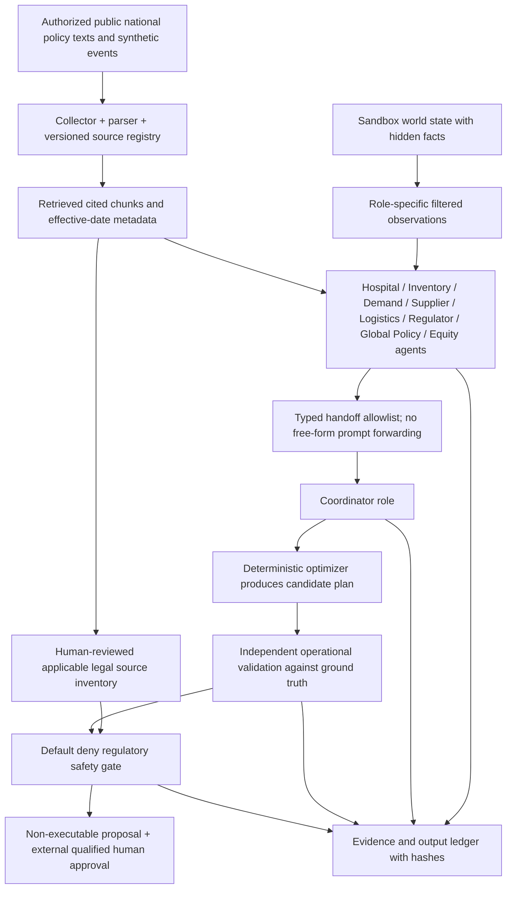

# Implementation-ready LLM agent architecture (v0.4)

**Status:** `council.py` implements bounded orchestration in offline scripted mode and opt-in API role calls; the design below adds proposed production/sandbox controls. A live provider has **not** been tested or approved.

## Data flow and trust boundaries



### Suggested message schema for live integration

```json
{
  "protocol_version": "0.4",
  "scenario_id": "CASE-001",
  "role": "Supplier",
  "scope": "synthetic_only",
  "observation_version": 1,
  "visibility": "private_role_scoped",
  "assessment": {"summary": "Request formal disclosure", "cited_claim_ids": [], "open_questions": []},
  "handoff": {"intent": "REQUEST_FORMAL_DISCLOSURE", "has_private_information": true,
               "legal_clearance": false, "content_policy": "no_free_text_forwarding"},
  "release": {"status": "HUMAN_REVIEW_REQUIRED", "transfer_authorized": false}
}
```

The live schema above is **target architecture**, not guaranteed runtime output for every version. In v0.4, the input/handoff/output fields are in `council.run_council`, `agents.observe`, `llm.validate_agent_result`. `record_sha256` commits the exported record to the hash-chained audit event.

## Ten role boundaries

| Role | Can access in current offline system | May emit | Must never do |
|---|---|---|---|
| Hospital | Synthetic sites | Shortage assessment | Use patient health records |
| Inventory | Site inventory | Stock/reserve checks | Authorize shipments |
| Demand | Synthetic sites | Demand estimates | Prescribe or reprioritize real patients |
| Supplier | Route data and private supplier events | Disclosure request and capacity insight | Leak private unreleased route numbers |
| Logistics | Known routes, formally disclosed events | Feasibility concerns | Assume unknown route capacity |
| Regulator | Curated public source claims | Applicable-law research questions | Issue authority or permits |
| GlobalPolicy | EU/WHO comparative sources | Distinct-jurisdiction comparisons | Treat EMA as UAE regulator |
| Equity | Site data + invented nonclinical priorities | Distribution disparity flags | Claim clinical triage significance |
| Coordinator | Validated shared facts and typed notices | Candidate coordination path | Receive hidden capacity pre-disclosure |
| Auditor | Role ledger and true simulation check | Integrity and uncertainty report | Self-authorize or secretly edit plan |

## Provider boundary & safety architecture

1. **No network by default**. `OfflineProvider` is deterministic and independent of model availability.
2. Optional `OpenAIProvider` makes one restricted assessment per selected role. User must set credential locally. API URL defaults exactly to official HTTPS endpoint; custom URLs require explicit risk acknowledgment and HTTPS.
3. Input filtering happens **before** API calls in `agents.observe`. Each role receives only named fields; retrieved source text is treated as untrusted data.
4. `llm.validate_agent_result` accepts only typed, bounded outputs with allowlisted references, and returns `autonomous_transfer_authorized=false` without exception.
5. Free-form model output is **not** forwarded into another model's prompt. Only `intent`, `from`, `evidence_ids`, `has_private_information`, and fixed safety flags are forwarded.
6. Independent numeric checks use the real simulated world, not the model belief state. Regulated real-world actions are **not implemented**.
7. Full internal hidden chain-of-thought is not requested or stored. Visible rationales, cited evidence, actions, constraints and review status are recorded instead.
8. Retained logs need signed/tamper-resistant infrastructure before use beyond research. SHA-256 chaining alone does not establish authenticity.

## Standards mapping — architectural analogy, not a certification

| ITU-T Y.3172 functional block | MedRoute mapping |
|---|---|
| SRC, C | Synthetic scenario feed + authorized document registry / collector |
| PP | Text ingestion, provenance normalization and role-specific data filters |
| M | LLM role assessments + numerical optimization |
| P | Independent operational and regulatory gate |
| D, SINK | Evidence dossier/dashboard and human-review workflow |
| MLFO | `run_council` bounded orchestrator; future tool/model selection interface |
| ML Sandbox | Isolated synthetic `Sandbox`, test harness, intentionally incomplete observations |

Y.3172 was written for ML in future telecommunications networks. The above is a **cross-domain architectural correspondence required by the contest**, not formal Y.3172 compliance.

## Prioritized next engineering tasks

1. Add live-provider cassette-based regression for HTTP payloads/responses **only after express user authorization for actual calls**, then verify privacy, latency, cost and error paths.
2. Add bounded tool APIs for document retrieval with section-level citations, effective dates and mandatory source type labels. Do not inject raw fetched webpages into system instructions.
3. Add multiple scripted **domain-specific** uncertain-policy cases and independent expert ground truth; run agent-output scorecards with abstention as a valid outcome.
4. Add source versioning and legal-review queue, policy evidence evidence-gap categories and conflict resolution under separate jurisdictions.
5. Separate publication artifacts from secret configuration; no real patient/institution stock data in either code or telemetry.
