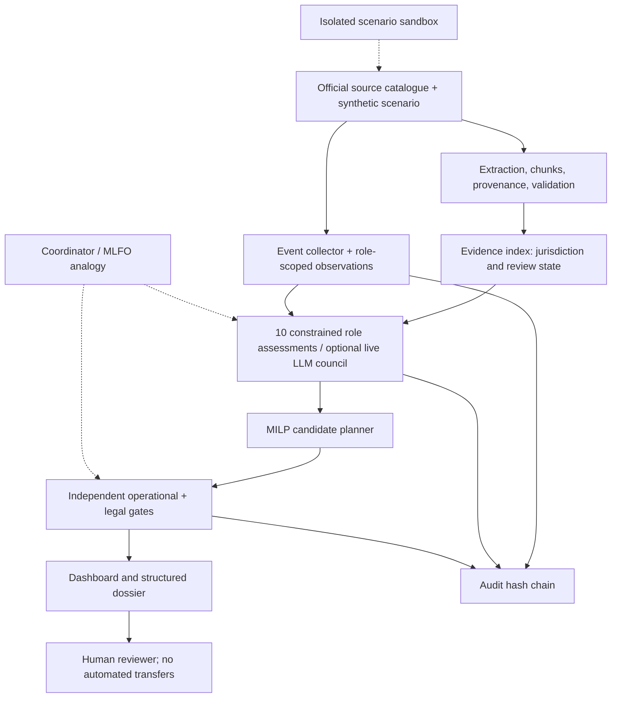

# Architecture and standards traceability

## ITU-T Y.3172 reflection (analogy, not conformance certification)

| Y.3172 concept | MedRoute X design |
|---|---|
| Source (SRC) / Collector (C) | Official source index and synthetic inventory + event collector |
| Preprocessor (PP) | Local PDF/text chunking with page/sha256 provenance, curated evidence index |
| Model (M) | Role-scoped assessments plus reproducible integer optimizer |
| Policy (P) | Operational validity, permission unknown, human review and jurisdiction handling |
| Distributor (D) / Sink | Dashboard, downloadable evidence dossier and human approval interface (review only) |
| ML function orchestrator (MLFO) | Role coordinator, typed event protocol and stepwise scenario engine |
| Sandbox | Isolated synthetic experiment independent from any real clinical system |

The telecom standard does not certify healthcare systems; this is a **documented mapping of software responsibilities**.

## ITU AI Readiness Framework 2.0 reflection

- **Data:** real official source metadata, synthetic stock data, source status and reproducibility; next: comprehensive authoritative corpora and privacy DPIA.
- **Digital infrastructure:** offline Python sandbox; next: secured deployment and resilient integration with authorized institutional systems.
- **Digital skills:** reviewers need pharmaceutical compliance and AI literacy; tool output is explanatory, not autonomous.
- **Innovation ecosystem:** reusable provenance schema, deterministic tests and potential ITU-contributed open dataset (license review required).
- **AI policy:** default-deny regulated actions, jurisdiction-specific comparison, human authority, research questions differentiated from confirmed law.

## Multi-agent council (new in v0.3)

`observe()` applies role-level access controls before each role assessment. Eight specialist results are converted to allowlisted messages (intent, evidence IDs, has-private-information bit, no raw text). The Coordinator reads those structured notices; independent Auditor reads notices and an operational check calculated separately from the model. Supplier can signal an alert without revealing the secret route capacity until formal disclosure. The typed protocol prevents accidental free-form prompt injection propagation, but it has not undergone a comprehensive security audit.

All model advice is **non-executable** and the operational optimizer never delegates legal permission to LLM outputs. The default provider is scripted, not generative. Real model execution is opt-in (`OPENAI_API_KEY`) and is not live tested in this deliverable.
